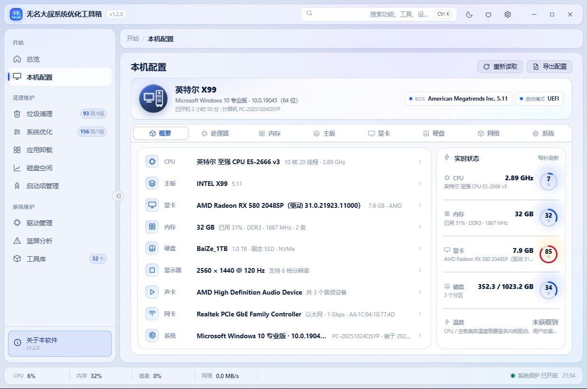
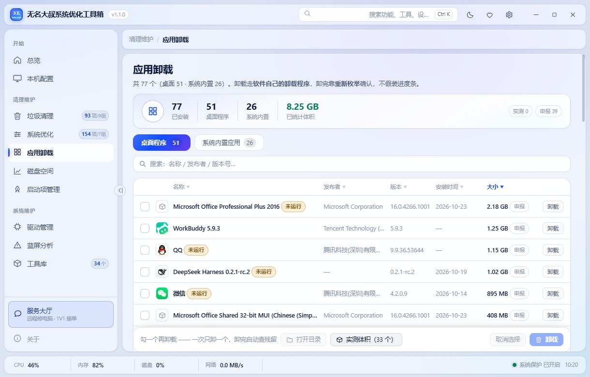
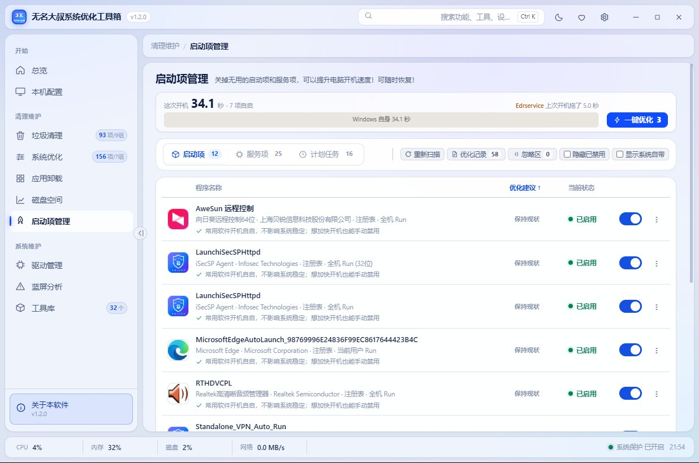

# 3z9wOpt — Windows Cleaner, Optimizer & System Toolbox

**English** · [简体中文](README.md)

A portable Windows cleaner and optimizer in a single 15 MB executable. Clear junk files, switch off the settings that slow Windows down, uninstall apps and sweep up what they leave behind, see what is actually eating your disk, back up driver packages, read blue-screen crash dumps, and run 34 built-in repair tools — all from one window.

- **93 cleanup targets in 9 groups**, including AI app caches and dead registry entries
- **154 system tweaks**, each one reversible on its own
- **34 repair tools**, grouped by the problem you are trying to solve rather than by command
- **No installer, no telemetry, no account** — unzip and run


[Download](https://opt.3z9w.com) · [Website](https://www.3z9w.com) · [Changelog](更新记录.md) · [Gitee mirror](https://gitee.com/opt3z9w/3z9wopt)

Windows 10 and 11 · GPLv3 · 15 MB single executable

---

## What it does

### Overview

Scans the machine on launch and tells you what to fix first and what to leave alone.

- **Five checks on one screen** — junk files, startup items, free disk space, RAM usage, pending reboot; each one marked OK or needs attention
- **Three next actions** — each with a rough time estimate, one click to jump to the page that fixes it
- **Health score** — the five results rolled into a single number

### Hardware info

Reads what the machine actually is, down to memory module model, slot and frequency; the whole report can be exported in one click.

- **CPUID / SMBIOS / WMI / DXGI, read directly** — no WMI class guessing
- **Which channel each stick sits in**, CPU cache and codename, motherboard, BIOS version, GPU
- **Unreadable values say "unavailable"** — never blank, never a made-up default

### Junk cleanup

Finds the temp files, caches, logs and traces left behind by Windows, browsers and everyday apps — then lets you decide what to delete. Pair it with the disk space analyzer to see what is really filling the drive first.

**9 groups, 93 targets:**

- **Temp files (4)** — user temp, system temp, recent items, broken shortcuts
- **Recycle bin (1)** — every drive
- **System cache (10)** — Windows Update and Delivery Optimization, Prefetch, DirectX shaders, thumbnails and icons, fonts, search index, WinSxS temp, RDP, .NET assemblies
- **Deep clean (9)** — WinSxS components (with `/ResetBase`), Defender quarantine, Windows.old, restore points, Installer patch cache, Office install sources, extracted driver leftovers, broken app packages, stray files across all drives
- **Logs and registry (12)** — WER, crash dumps, event logs, IIS logs, diagnostic data, dead MuiCache / App Paths / SharedDLLs links, keys left by uninstalled software, invalid COM registrations
- **Browser cache (7)** — Edge, Edge AI components, Chrome, Firefox, IE, other Chromium browsers, cookies
- **App cache (26)** — WPS, Office, Adobe, QQ / WeChat / DingTalk, Thunder, cloud drives, Steam, VS Code, JetBrains, Discord, Zoom, NetEase Cloud Music, Douyin Live Studio, and more discovered automatically
- **AI app cache (19)** — Doubao, Jianying, Kimi, Yuanbao, Tongyi, Ernie, Jimeng, ChatGPT, Claude, Cursor, Trae, DeepSeek, WorkBuddy, plus **local LLM weights** (Ollama / LM Studio — often several GB)
- **Usage traces (5)** — Run box, address bar, Office recent documents, open/save dialogs, browser history

**Three rules apply across the board:**

- **Path-level de-duplication** — a folder hit by several rules is counted once, so the total is never inflated
- **Per-account enumeration** — multi-account apps (QQ, WeChat, Thunder, Baidu Netdisk) are listed separately; you pick which account to clean
- **Traces are unticked by default** — you have to select them. Files in use are never force-deleted; they are queued for the next boot

### System optimizer

Turns off the switches in Windows that slow it down, push ads, or collect data. Anything you turn off can be turned back on, and every change stays in the log.

**154 tweaks in 7 categories:**

- **Performance (45)** — process count, shutdown and service-stop waits, SysMain / Windows Search / Error Reporting, large system cache, non-paged kernel memory
- **Privacy (34)** — activity history, advertising ID, diagnostic data, typing and writing habits, plus telemetry in .NET, PowerShell and the system itself
- **Appearance / Explorer (32)** — taskbar, Start menu recommendations, Notepad, file extensions, restart apps after a crash
- **System settings (14)** — hibernation, power off USB on eject, auto-restart on BSOD, disk check timeout
- **Edge (12)** — first-run page, background running, startup boost, Bing search ads
- **Windows Update (7)** — driver updates, feature updates, Malicious Software Removal Tool
- **Security (10)** — UAC, SmartScreen, firewall, memory integrity, virtualization-based security

**Also worth knowing:**

- **Basic preset (87 items) / Deep preset (127 items)**, or skip presets and tick items yourself
- **Every item has its own switch and its own undo** — you can stop halfway, or roll back just one item
- **Each item is marked as needing a reboot or not** — one-click optimize only ticks what actually measured slow on this machine, and you can untick any of it in the dialog

### App uninstaller

Uninstalls both desktop software and built-in Windows apps, then cleans up the registry keys and folders they leave behind.

- **Scans the leftovers** — registry keys, registry values (MuiCache / Run and similar), install folders; matched by program name, publisher and package ID
- **Only certain matches are ticked** — anything ambiguous is flagged ⚠ and cannot be ticked; the registry is exported first, and shared container keys are trimmed rather than deleted
- **Desktop and UWP apps in one list**
- **Size source is labelled** — measured / reported by the registry / unknown
- **Re-enumerates after uninstalling**, to confirm the entry is really gone
- Falls back to the registry for UWP enumeration on systems with PowerShell removed

### Disk space

Scans the drive and shows which folders and files take up the most room; run it before junk cleanup and you will free more.

- **Reads the NTFS MFT index directly** — millions of files in seconds, instead of calling `stat` on every directory
- **Drills down by real subtree size** — click in and see which level suddenly grows
- **Duplicate files are compared by full-content hash** — identical content only
- **Deletability is checked before anything is offered for deletion** — system, program, game, cloud-sync, key and in-use files make the whole group non-deletable, with no way to force it
- **When a file exists in two versions, the one in use is kept** — chosen by process locks and path risk, not by filename or date

### Startup manager

Manages what starts with Windows, so you can turn off what you do not need and boot faster.

- **All five native mechanisms** — registry Run keys, `StartupApproved` flags, services, scheduled tasks (including ones that start themselves), startup folders
- **Third-party entries only by default** — Windows' own can be shown with a toggle
- **Disabling writes the approval flag, never deletes the registry value** — always reversible
- **Services can only be stopped, not deleted**
- **Seconds saved are shown per item**, estimated from this machine's own boot records — not a fixed number copied from somewhere

### Drivers

Exports driver packages by category so you have a copy, then installs them back after a reinstall.

- **Grouped by device class** — third-party drivers only by default; built-in drivers currently in use appear with a toggle
- **Exports as `category / driver name`, whole package** — nothing ticked means export everything; Windows installs on other drives can be exported too
- **Add driver** — pick a folder, every `.inf` inside is installed recursively, which is how you roll back to an older version from a backup; this page does not delete drivers — use Device Manager for that

### BSOD analyzer

No WinDbg, no symbol server. Reads crash dumps directly and gives you the bug check code, the kernel call stack and the suspect driver in one pass.

- **Finds Minidump and MEMORY.DMP automatically** — 32-bit dumps are read for code and parameters; stack walking is x64 only
- **Built-in bug check table** — verdict, common causes and next steps for each parameter, so you do not have to search the code

### Toolbox

No internet, printer won't print, update won't install, Windows won't boot — the problems you actually hit. No need to remember which command to type.

- **34 tools in 7 problem-based categories** — connectivity, updates, system errors, boot, disks, system info, everyday utilities
- **Runs in the window** — live output, stop any time; tools that change the system take a backup, a restore point or a reboot reminder, and show exactly what they changed
- **Guided troubleshooting** — 10 symptoms (slow boot, full C drive, blue screen, no sound, no internet, printer or share unreachable…); pick one and it takes you to the right tool

---

## Screenshots

Taken from v1.1.0; light and dark themes both available.

| Overview | Hardware info |
| --- | --- |
|  |  |

| Junk cleanup | System optimizer |
| --- | --- |
|  |  |

| App uninstaller | Disk space |
| --- | --- |
|  |  |

| Startup manager | Drivers |
| --- | --- |
|  |  |

**Toolbox** — 34 tools in 7 problem-based categories, with the guided-troubleshooting list at the top.


## Download and install

Latest build: <https://opt.3z9w.com> (fast inside mainland China) or [Releases](https://github.com/3z9w/3z9wopt/releases).

Unzip and run the exe — there is nothing to install.

## Build from source

Go 1.26+, no `vendor/` directory, network available.

```powershell
build.cmd release
```

The whole UI is one file: `design/ui-prototype.html` (inline CSS and JS, no frontend build chain). Version and build date are injected at compile time, so a fresh clone reports its own values.

## FAQ

**Is it free?**
Yes. GPLv3 — use it, modify it, redistribute it, including commercially. If you distribute a modified version, it has to stay GPLv3.

**Does it work on Windows 11?**
Yes, Windows 10 and 11, x64. The UI renders in WebView2, which ships with Windows 11 and current Windows 10.

**Does it collect anything?**
No. No telemetry, no analytics, no account. Two things can touch the network, both started by you: the built-in speed test, and "check for updates" (one request, result shown in the window).

**Can I undo the optimizations?**
Yes. Every tweak has its own restore action, the operation log keeps a record, and you can roll back a single item without touching the rest.

**Why does my antivirus flag it?**
The binary is not code-signed. Some engines flag new, unsigned releases as suspicious. Check [the false-positive list](https://github.com/3z9w/3z9wopt/blob/main/docs/false-positive-names.md) for the exact detection names, verify the SHA256 published on the download page, or build it yourself.

**Does it need .NET or anything installed?**
No runtime to install. The exe is self-contained apart from WebView2.

## License

Released under [GPLv3](LICENSE):

- **Use, modify and redistribute freely**, including commercially
- **Distributed modifications must stay GPLv3** and keep the original copyright notice
- **No warranty** — use at your own risk

The "无名大叔" and "3z9wOpt" names, logo and donation QR code are not covered by the license; replace them in a fork.

Third-party components: see [THIRD-PARTY-NOTICES.md](THIRD-PARTY-NOTICES.md).
