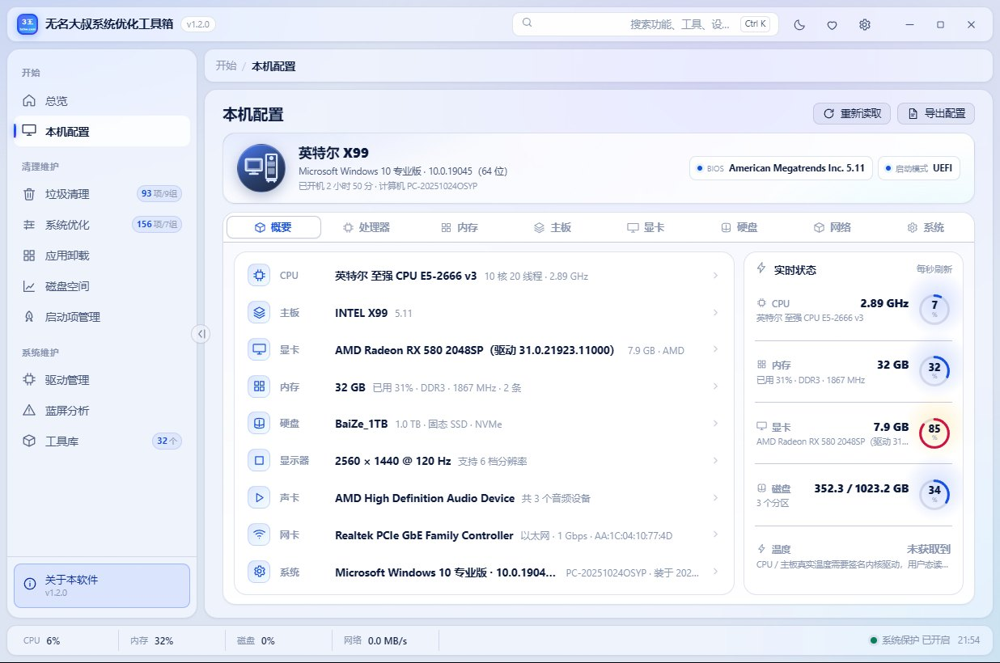
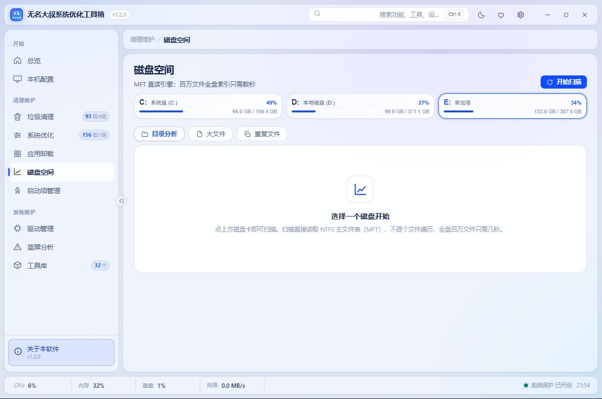
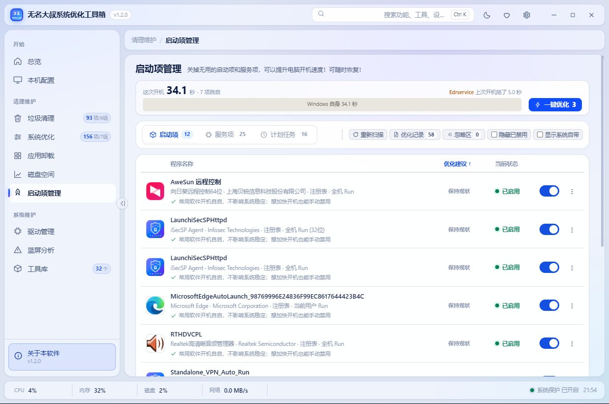

# 无名大叔系统优化工具箱（3z9wOpt）· Windows 清理与优化

一个能清理电脑垃圾、卸载软件、优化系统、管理开机启动项、分析磁盘空间占用、备份驱动、解读蓝屏、读取本机配置，共 10 个功能模块 + 32 个系统原生工具的 Windows 软件。  
垃圾清理覆盖 9 组 93 项，AI 应用缓存和注册表死链也能清。  
小巧、绿色、免安装，不联网、不收集任何数据。

[下载](https://opt.3z9w.com) · [官网](https://www.3z9w.com) · [更新记录](更新记录.md) · [Gitee 镜像](https://gitee.com/opt3z9w/3z9wopt) · [English](README.en.md)

已收录于阮一峰《科技爱好者周刊》[第 417 期](https://www.ruanyifeng.com/blog/2026/10/weekly-issue-417.html)

Windows 10 及以上系统通用 · GPLv3 开源授权 · 15 MB 单文件，解压即用

---

## 功能

### 总览

开机先扫一遍，一屏看清哪里有问题、接下来先动哪个。

- **体检五项**：垃圾文件、启动项、磁盘空间、内存占用、待重启，逐个标出正常还是异常
- **3 条待办**：标出大概耗时，点一下跳到对应页面
- **健康分**：把五项结果汇总成一个分数

### 本机配置（机器配置读取）

一眼看清这台机器的配置，内存条型号、插槽、频率都直接列出来；整机信息支持一键导出。

- **CPUID / SMBIOS / WMI / DXGI 直读**
- 具体到**插在哪个通道**，CPU 缓存与代号，主板、BIOS 版本、显卡
- **读不到的项写「读不到」**，不留空白也不填默认值

### 垃圾清理

把系统、浏览器和常用软件产生的临时文件、缓存、日志、使用痕迹扫描出来，由你决定是否删除！结合磁盘空间占用分析功能，彻底释放硬盘空间，C 盘不再爆红。

**共计 9 组 93 项：**

- **临时文件清理（4 项）**：用户临时、系统临时、最近使用记录、失效快捷方式
- **回收站清理（1 项）**：所有磁盘的回收站
- **系统缓存清理（10 项）**：更新与传递优化、Prefetch、DirectX 着色器、缩略图与图标、字体、搜索索引、WinSxS 临时、RDP、.NET 程序集
- **深度清理（6 项）**：WinSxS 组件（含 `/ResetBase`）、Installer 补丁缓存、Office 安装源、驱动解压残留、损坏应用包、全盘零散垃圾
- **日志与注册表清理（11 项）**：WER、崩溃转储、IIS 日志、系统诊断数据、MuiCache / App Paths / SharedDLLs 死链、已卸载软件残留键、无效 COM 注册
- **浏览器缓存清理（9 项）**：Edge、Edge AI 组件、Chrome、Firefox、IE、其他 Chromium 系、Cookies、浏览器更新残留、旧版本残留
- **应用缓存清理（27 项）**：WPS、Office、Adobe、QQ / 微信 / 钉钉、迅雷、网盘、Steam、VS Code、JetBrains、Discord、Zoom、网易云、抖音直播伴侣，其余自动发现
- **AI 应用缓存清理（19 项）**：豆包、剪映、Kimi、元宝、通义、文心、即梦、ChatGPT、Claude、Cursor、Trae、DeepSeek、WorkBuddy，以及**本地大模型权重**（Ollama / LM Studio，动辄几 GB）
- **使用痕迹清理（5 项）**：运行框、地址栏、Office 最近文档、打开 / 保存对话框、浏览器历史

**另外还有三条通用规则：**

- **按路径去重**：同一目录被多条规则命中只算一次，汇总数字不会重复累加
- **按账号枚举**：QQ、微信、迅雷、百度网盘的多账号数据分开列，清哪个账号自己选
- **痕迹类默认不勾**，要清得自己手动选；被占用的文件不硬删，排到下次开机清

### 系统优化

把 Windows 里拖慢速度、推送广告、收集数据的开关逐项关掉，提升系统运行速度和响应！关掉的项目也可以回滚重新打开，优化记录全部保留。

**共计 156 项，分 7 类：**

- **性能优化（44 项）**：进程数量、关机与关服务等待、SysMain / Windows Search / 错误报告、大系统缓存与内核不分页
- **隐私设置（35 项）**：活动历史、广告 ID、诊断数据、键入与写作习惯，以及 .NET / PowerShell / 系统三处遥测
- **外观 / 资源管理器（33 项）**：任务栏、开始菜单推荐、记事本、显示扩展名、崩溃后自动重启
- **系统设置（16 项）**：休眠、USB 弹出后断电、蓝屏自动重启、磁盘检查等待时间
- **Edge 优化（12 项）**：首次运行页、后台常驻、启动增强、必应搜索广告
- **更新设置（7 项）**：驱动随更新、大版本更新、恶意软件删除工具
- **安全设置（9 项）**：UAC、SmartScreen、防火墙、内存完整性、虚拟化安全性

**另外还有三条：**

- **基本预设 84 项 / 深度预设 122 项**，也可以完全不套预设，自己一项一项勾
- **每项单独开关、每项有自己的还原动作**，能中途停，也能只退回改过的那一项
- **逐项标注是否需要重启**；一键优化只勾实测拖慢开机的项，弹窗里可逐项取消

### 应用卸载

卸载桌面软件和系统内置应用，卸完之后还能清理残留的注册表和目录！

- **卸完扫残留**：注册表项、注册表值（MuiCache / Run 这类）、安装目录一起扫，按程序名 / 发布者 / 安装包编号比对，命中就列出来
- **默认只勾确定属于它的**，判不准的标 ⚠ 且不让勾；清之前先导出注册表备份，共用容器键只摘值不删键
- 桌面软件 + 系统内置应用（UWP）都在一个列表里
- **体积标注来源**：实测 / 注册表申报 / 未知
- **卸完重新枚举一次**，确认条目真的消失了
- PowerShell 被精简的机器上，UWP 枚举自动回退到注册表

### 磁盘空间

扫描磁盘上的文件，快速找出哪些文件夹、哪些文件占地方最大；配合垃圾清理一起用，先定位再清，能腾出更多闲置空间。

- **直读 NTFS 的 MFT 索引**：百万级文件量也能在几秒内出结果，不用逐个目录 stat
- **按真实子树大小逐层下钻**：点进去能看到是哪一层突然变大
- **重复文件按全量哈希比对**：内容完全一致才判为重复
- **重复文件先判能不能删**：系统 / 程序 / 游戏 / 云同步 / 密钥 / 正在占用的，整组禁删且不提供解锁
- **同一个文件有新旧两份时，留正在用的那份**：按进程占用和路径风险挑正本，不按文件名或日期随便留一个

### 启动项管理

管理开机时自动运行/启动的东西，把不需要的关掉，提升开机速度。

- **五套原生机制都枚举**：注册表 Run、StartupApproved 审批位、服务、计划任务、启动文件夹，计划任务里自启的项也能看到
- **默认只列第三方软件装的**，系统自带的可切换查看
- **禁用只写审批状态位，不删注册表值**，随时能开回来
- **服务项只允许停用，不允许删除**
- **关掉能省几秒，直接标在每一项上**：按本机开机记录估算，不是套用的固定数字

### 驱动管理

把驱动包按类别整包导出来留个底，重装系统后照着列表装回去。

- **按设备类别归组**：默认只列第三方驱动，勾上「显示内置驱动」才连系统自带、正在用的那批一起列
- **导出按「类别 / 驱动名」分目录整包拷**：不勾选就是导出全部，别的盘上的 Windows 也能导
- **添加驱动**：选一个文件夹，递归装里面所有 .inf，从备份装回旧版本就靠这个；本页不删驱动，删驱动请去设备管理器

### 蓝屏分析

不装 WinDbg、不连符号服务器，直接读转储文件：BugCheck 代码释义、内核调用栈、嫌疑驱动一次给全。

- **自动扫 Minidump 与 MEMORY.DMP**：32 位转储也能读代码和参数，栈回溯只做 x64
- **内置常见 BugCheck 码表**：结论、常见原因、处理建议都对具体参数给，不用自己拿代码去搜

### 工具库

上不了网、打印机罢工、更新装不上、开不了机，这些平时最常碰到的问题，不用记该敲哪条命令，点一下就行。

- **32 个工具按问题分 7 类**：上不了网、更新装不上、系统报错、开不了机、磁盘异常、查本机情况、日常小工具
- **点一下就跑**：输出在界面里实时滚动、随时可停；动系统的带备份、还原点或重启提醒，跑完能看到改了什么
- **对症排查**：开机慢、C 盘爆满、蓝屏、没声音、上不了网、打印机连不上等 10 条症状，选一条直接跳到对应工具

---

## 下载与安装

最新版：<https://opt.3z9w.com>（国内直连）或 [Releases](https://github.com/3z9w/3z9wopt/releases)。

解压后双击 exe 就能用，不用安装。

**如果杀软把它拦了**，多半是误报：软件没有代码签名，部分引擎会把新版本判成风险程序。

1. 把文件加进信任区 / 白名单，再运行
2. 不放心就核对 SHA256（发布页上有），或者干脆自己编译
3. 哪些引擎报了什么名字：[误报检测名清单](https://github.com/3z9w/3z9wopt/blob/main/docs/false-positive-names.md)

## 截图

v1.1.0 实拍，支持浅色 / 深色两套主题。

| 首页 | 本机配置 |
| --- | --- |
|  |  |

| 垃圾清理 | 系统优化 |
| --- | --- |
|  |  |

| 应用卸载 | 磁盘空间 |
| --- | --- |
|  |  |

| 启动项管理 | 驱动管理 |
| --- | --- |
|  |  |

**工具库**：32 个工具按问题分 7 类，页顶是「对症排查」的 10 条症状。

## 许可

本项目以 [GPLv3](LICENSE) 授权发布：

- **可以自由使用、修改、再发布**，也可以用于商业用途
- **分发修改版时须同样以 GPLv3 开源**，并保留原作者版权声明
- **不提供任何担保**，使用风险自负

「无名大叔」和「3z9wOpt」的名称、Logo、赞赏码不在授权范围内，fork 后请替换成你自己的。

第三方组件许可见 [THIRD-PARTY-NOTICES.md](THIRD-PARTY-NOTICES.md)。
