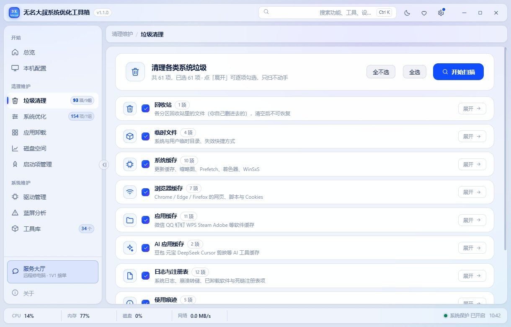
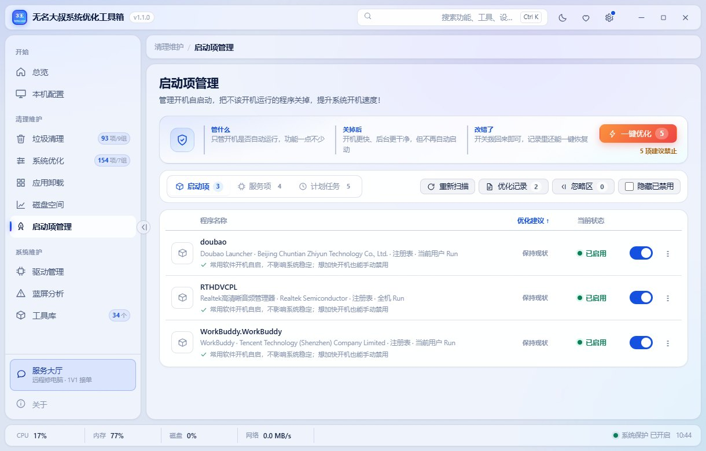

# 无名大叔系统优化工具箱（3z9wOpt）

[](LICENSE)
[](#)
[](#)
[](https://github.com/3z9w/3z9wopt)
[](https://gitee.com/opt3z9w/3z9wopt)


> **Windows 系统优化工具箱** —— 清理垃圾、按需优化、管理启动项与驱动、看磁盘占用、读蓝屏原因。
> 前端是 Go + Wails v2 + WebView2 的桌面程序，**所有数据真读本机，读不到就写「读不到」，不编造**。
>
> A Windows optimization toolbox written in Go (Wails v2 + WebView2). It reads real data from your machine —
> **when a value can't be read, it says so instead of making one up** — and never sends anything to a server.

- **状态**：v1.1.0 已发布（14 个页面全部接真数据，持续更新中）
- **开源起点**：v1.0 曾作为**闭源**软件发布；**本仓库从 v1.1 起开放源码** —— 因此仓库里没有 1.0 的历史提交，
  已发布的 1.0 版本维持原样，不再单独开源。
- **官网**：<https://www.3z9w.com>（介绍、使用文档、远程服务）
- **发布页 / 下载**：<https://opt.3z9w.com>（最新版、体积与 SHA256 校验值、更新记录）
- **开源仓库**：<https://github.com/3z9w/3z9wopt>（主）／ Gitee 镜像 <https://gitee.com/opt3z9w/3z9wopt>（同一份代码，国内访问快）
- **系统要求**：Windows 10 22H2 / 11（本机实测 10.0.19045）+ WebView2 Runtime
- **许可**：[GPLv3](LICENSE)（可自由使用、修改、分发，含商用；**二次分发必须同样开源**）

---

## 它能做什么

| 模块 | 说明 |
|---|---|
| 垃圾清理 | 93 项 / 9 组，路径级去重（同一目标只算一次体积），扫描只读、清理前可勾选 |
| 系统优化 | 154 项 / 7 组（基本 87 · 深度 127），**每项可单独还原**，标注「需重启」 |
| 应用卸载 | 桌面软件 + 系统内置应用，标注体积来源（实测 / 申报 / 未知），走系统卸载程序并**重新枚举确认** |
| 磁盘空间 | 直读 NTFS 的 MFT 索引，按**真实子树大小**逐层下钻，另列最大文件 |
| 启动项管理 | 按 Windows 原生机制枚举：注册表 Run / `StartupApproved` 审批状态 / 服务 / 计划任务 / 启动文件夹。默认只列第三方装的，可切「显示系统自带」；禁用写系统审批位而不是删注册表值，随时能改回来 |
| 驱动管理 | 驱动存储里的第三方驱动包：导出备份、从备份装回、删除旧包（**不比对"有没有新版本"**——那要去官网逐个核对，没把握的事不做） |
| 蓝屏分析 | 扫 Minidump / MEMORY.DMP，解析 BugCheck 代码、参数、常见原因、处理建议与嫌疑驱动 |
| 工具库 | 34 个可直接跑的系统工具（SFC / DISM / 网络修复 / 引导修复…），**真执行 + 实时输出 + 可停止** |
| 快速排查 | 按症状自查（上不了网 / 黑屏 / 打印机连不上…），一键跳到对应工具或页面 |
| 本机配置 | CPUID / SMBIOS / WMI / DXGI 真读：CPU 缓存与代号、内存条与通道、显卡、主板、BIOS |
| 服务大厅 | 一键生成诊断报告（复制到剪贴板），可发给维修人员 |

## 常见场景（我该点哪个？）

| 你遇到的 | 用它 |
|---|---|
| C 盘红了、不知道空间被谁占了 | **磁盘空间**（按真实子树大小逐层往下钻） |
| 开机越来越慢 | **启动项** + **垃圾清理** |
| 电脑越用越卡、内存快满了 | **系统优化**（154 项，可逐项还原） |
| 装了一堆软件，卸了还留残余 | **应用卸载** |
| 蓝屏了，代码看不懂 | **蓝屏分析** |
| 上不了网 / 打印机连不上 / 黑屏只剩鼠标 | **快速排查**（按症状自查，一键跑工具） |
| 想确认这台机器的真实硬件 | **本机配置**（读不到就写「读不到」） |
| 驱动装乱了，想备份 / 清掉旧包 | **驱动管理** |
| 想干点系统活但手头没趁手工具 | **工具库**（34 个，真执行 + 实时输出） |

## 设计原则（这个软件**不**做什么）

1. **不编造数据**：任何拿不到的值都显示「读不到」；不做"预计开机 47 秒"这类没有依据的估算。
2. **不做没把握的事**：例如不比对驱动版本（无法可靠判断谁更新），只做能确定的事。
3. **每一步可追溯、可撤销**：操作日志记录每次改动，优化项支持逐项还原、一键全部恢复。
4. **危险操作三段式确认**：会发生什么 / 影响面多大 / 怎么撤回。
5. **不上报、不统计、无遥测**：代码里没有任何上报逻辑。联网的只有两处，且都得你主动点：
   「网络测速」工具本身，以及设置里点「检查更新」时访问一次发布页取版本清单（结果只显示在窗口里，不打开浏览器）。
6. **首屏不啰嗦**：首页打开即全部展现，不需要拉滚动条。

## 截图

| 首页 | 垃圾清理 |
|---|---|
|  |  |
| 系统优化 | 启动项管理 |
|  |  |
| 磁盘空间 | 本机配置 |
|  |  |

（v1.1.0 实拍，1220×780，界面支持浅色 / 深色两套主题）

---

## 下载与使用

> 最新版：[Releases](https://github.com/3z9w/3z9wopt/releases) 或发布页 <https://opt.3z9w.com>（国内直连）。
> Gitee 镜像 <https://gitee.com/opt3z9w/3z9wopt> 上是同一份源码。也可以从源码构建（见下）。

使用建议：
- 第一次用，先在「工具库 → 创建系统还原点」建一个还原点（软件内也有入口）；
- 清理 / 优化类操作**扫描都是只读的**，勾选后才动手；
- 出问题可在「设置 → 操作日志」里看每次改动，能还原的直接点按钮。

## 从源码构建

要求：Go 1.26+ 、Windows 10 22H2+、能联网拉依赖（仓库**没有 vendor/**）

```powershell
# 正式程序（不弹控制台）
#   版本号与构建日期在编译时注入，源码里不写死 —— 别人 clone 构建不会顶着作者的日期
go build -tags desktop,production -ldflags "-s -w -H windowsgui -X main.appVersion=1.1.0 -X main.buildDate=2026-10-16" -o bin\3z9wOpt_v1.1.0.exe .

# 带控制台的自检版（-cli / -perf 需要）
go build -tags desktop,production -ldflags "-X main.appVersion=1.1.0 -X main.buildDate=2026-10-16" -o bin\3z9wOpt_cli.exe .
```

不带 `-X` 直接构建也能用，界面会显示 `v1.1.0-dev · 构建 unknown`。

### 版本号规则（两级，各管一件事）

| | 版本号 `version` | 构建号 `build` |
|---|---|---|
| 长什么样 | `1.1.0` | `20261019.3`（日期 + 当天第几次） |
| 谁改 | 手改 `build.cmd` 顶部 `APPVER` | `build.cmd release` 自动算 |
| 表示什么 | 功能集合 / 对外的第几个大版本 | 同一版本号的第几次发布 |

**改功能、修 bug 都不用动版本号**，跑一次 `build.cmd release` 就行：构建号往前走，老用户照样收到更新提示。
构建号由 `发布\构建台账.json` 生成，那份台账是唯一事实来源，不要手改。

构建方式：

```powershell
build.cmd            # 日常构建，产 bin\3z9wOpt_v1.1.0-dev.exe（不检查更新，不会被误传）
build.cmd release    # 正式发布：算构建号 → 编译 → 打 zip → 写台账 → 生成 version.json → 同步官网
```

注意事项：
- 根目录的 `app.ico` 与 `rsrc.syso` 决定 exe 图标，**不要删**；
- `frontend/dist/` 里可以放你自己的二维码素材（见该目录的 README），没有也能正常编译；
- 界面全部在 `design/ui-prototype.html` 这**一个文件**里（CSS + JS 内联），改界面不需要前端构建链。

### 命令行开关

| 开关 | 用途 |
|---|---|
| `-cli` | 控制台自检：清理项 / 优化项 / 扫描耗时等 |
| `-cli -nofull` | 同上，跳过全盘遍历（快） |
| `-perf` | 打印一条性能快照（CPU / 内存 / 磁盘 / GPU） |
| `-devpage <页面id>` | 启动后直接跳到指定页（截图验收用） |

## 目录结构

```
main.go                  窗口、embed、路由
design/ui-prototype.html ★前端本体（单文件）
frontend/dist/           可选素材（二维码等）
app.ico / rsrc.syso      exe 图标资源

junk_*.go        垃圾清理        optimize*.go   系统优化
appclean*.go     应用卸载        space.go mftscan.go  磁盘空间
startup.go       启动项          drivers.go     驱动管理
bsod.go          蓝屏分析        toolkit*.go tools_*.go  工具库
hwspec*.go hwdev.go hwlive*.go pcinfo.go  硬件真读
perf.go          实时性能        service.go     服务大厅 / 关于
oplog.go         操作日志        winstate.go    窗口记忆
```

## 开发与验收

改任何东西之后，建议按这个顺序验一遍（本项目就是这么干的）：

```powershell
# 1) 前端语法（把内联 <script> 抽出来交给 node）
#    这一步抓到过多次"整页白屏"级错误
node --check check.js

# 2) 后端
go vet .
go test -count=1 .

# 3) 构建（见上）

# 4) 截图确认（关键：抓了图一定要打开看）
```

## 已知问题 / Roadmap

- [x] UWP（系统内置应用）枚举：PowerShell 被精简/损坏的机器上自动回退到注册表枚举（2026-10-09）
- [ ] 应用「实测体积」入口：~~目前列表里的体积多为注册表申报值（已标注来源）~~ ✅ 2026-10-09 已接上（单个 + 批量逐个实测，进度可见、可中止）
- [x] 版本号口径统一：拆成「版本号 + 构建号」两级，改 bug 不用再升版本号（2026-10-19）
- [ ] 界面国际化（目前仅简体中文）
- [ ] 单元测试覆盖：硬件读取、清理引擎已有测试，界面层还没有

## 免责声明

本工具会**修改系统设置**（服务启动类型、注册表项、计划任务、系统参数等）。

- 软件自带操作日志与还原能力，但**请先创建还原点**；
- 在公司电脑、生产环境、他人机器上使用前请自行评估风险；
- 因使用本软件造成的任何直接或间接后果，由使用者自行承担。

## 许可

[GPLv3](LICENSE) © 2026 无名大叔 (<https://www.3z9w.com>)

可以自由使用、修改、分发，商用也行。

**但如果你把改过的版本分发给别人，就必须同样以 GPLv3 开源，把你的源码一并给出。** 这是 GPL 和 MIT 最大的区别，也是我选它的原因——不想有人拿去改改就闭源卖钱。

> **名称与标识不在授权范围内**：GPLv3 只授权代码。「无名大叔」「3z9wOpt」名称、作者 logo 与赞赏码
> 属于作者本人，fork 后请替换成你自己的（`app.ico` / `rsrc.syso` / 界面里的品牌文字）。
>
> 程序内使用的第三方开源模块及其完整许可原文见 **[THIRD-PARTY-NOTICES.md](THIRD-PARTY-NOTICES.md)**（10 个模块，均为 MIT / BSD 系，与 GPLv3 兼容）。
>
> 仓库里包含作者的**赞赏码**（`frontend/dist/zanshang-qr.png`），仅用于支持这个项目的持续开发；
> 你 fork 后可以直接删掉它（程序检测不到文件时会自动隐藏该入口）。

## 界面说明

界面图标是**项目自绘的内联 SVG 线性图标**（24×24、stroke 1.75 的通用线性风格，风格接近 Fluent / Feather
这类常见线性语言），**不是任何第三方图标库的文件拷贝**。若你认为某个图标与某开源图标集构成实质性相同，
欢迎开 Issue 指出 —— 我们会补上署名或直接替换。

## 联系与致谢

- 作者：无名大叔 · <https://www.3z9w.com>
- 问题反馈：欢迎开 Issue（附上系统版本与复现步骤）
- 致谢：[Wails](https://wails.io/) · [WebView2](https://developer.microsoft.com/microsoft-edge/webview2/) 以及 `go.mod` 中列出的所有依赖
